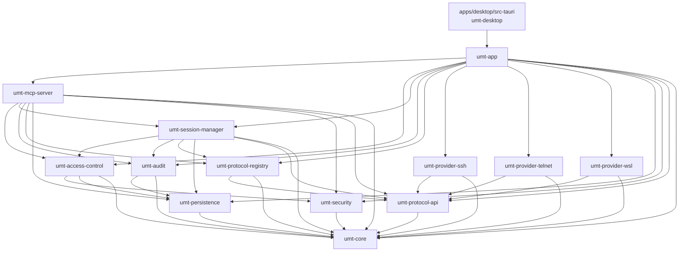

# Universal MCP Terminal 架构总览

> 本文描述当前仓库中**已经存在**的实现，不描述规划中的能力。
> 相关代码：`Cargo.toml`、`crates/**`、`apps/desktop/**`。

## 一、Crate 依赖图

箭头方向为「依赖方 → 被依赖方」，与各 `Cargo.toml` 中的 `umt-*` 依赖一致。
`umt-core` 是唯一没有内部依赖的底座；`umt-protocol-api` 只依赖 `umt-core`。



关键约束（由依赖图直接保证）：

1. `umt-core`、`umt-protocol-api` 不依赖 tokio、网络、数据库或任何具体协议。
2. 三个 Provider crate 只依赖 `umt-core` 与 `umt-protocol-api`，不依赖持久化、审计、访问控制或会话管理。
3. `umt-mcp-server`、`umt-session-manager`、`umt-access-control`、`umt-audit` 都不 `use umt_provider_*`。
4. `umt-access-control` 不反向依赖 `umt-session-manager`：撤销联动通过 `SessionRevoker` trait 在启动时注入。
5. 只有 `umt-app` 同时认识所有 Provider，并在 `AppState::initialize_with_keystore` 中完成注册与装配。

## 二、一次 MCP 工具调用的完整链路

以 `execute_command(connection_id, command)` 为例（`session_id` 路径除授权步骤外相同）：

```text
AI 客户端
  │  POST http://127.0.0.1:47321/mcp
  │  Authorization: Bearer umt_xxxxxxxx_<64 hex>
  ▼
rmcp StreamableHttpService（axum 挂在 /mcp）
  ▼
UmtMcpServer::call_tool
  1. bearer_from_context：只从 HTTP header 取 Authorization，绝不相信工具参数
  2. parse_bearer：要求 Bearer 方案、非空 Token
  ▼
AccessControl::authenticate
  3. prefix 解析 → TokenRepo::find_by_prefix
  4. TokenService::verify：HMAC-SHA256(pepper, token) + 常量时间比较
  5. ensure_token_usable：active / 未过期
  6. touch_last_used → TokenContext { token_id, token_name, client_info }
  ▼
UmtMcpServer::execute_tool（工具名白名单 + serde 参数解析）
  ▼
AccessControl::authorize_connection
  7. Token 仍存在且可用（防止长会话期间被禁用/撤销）
  8. 连接存在
  9. 连接 enabled
 10. token_connection_grants 中存在 allowed = true 的授权
  ▼
ProtocolRegistry::require(connection.protocol_id)
  ▼
能力校验：Provider.descriptor().capabilities 必须包含 Exec
  ▼
McpDeps.configs.get_config + SecretRepo.get + SecretCipher.decrypt
 11. 非敏感配置来自 connections.config_json
 12. 敏感字段来自 connection_secrets（AES-256-GCM），只在内存中合并
 13. HostKeyRepo 查询已信任指纹（SSH 未知指纹 → 拒绝）
  ▼
SessionManager::open
 14. 检查连接 enabled、活动会话上限
 15. Provider.connect(config, ConnectOptions) → Box<dyn TerminalSession>
 16. 写入 sessions 表
 17. AuditService.record(SessionOpened)
  ▼
SessionManager::exec
 18. owned(session_id, token_id)：跨 Token 直接 AccessDenied / NotFound
 19. TerminalSession::exec(ExecRequest)
 20. AuditService.record(CommandExecuted)：命令、输出摘要、退出码、状态、耗时
 21. 临时会话由 handler 负责 close，并记录 SessionClosed
  ▼
返回 CallToolResult::structured(JSON)
```

其它工具的分支：

| 工具 | 鉴权步骤 | 会话归属 | 能力校验 | 审计 |
|---|---|---|---|---|
| `list_connections` | authenticate | — | — | 无（只读列表） |
| `get_connection_info` | authenticate + authorize_connection | — | — | 无 |
| `test_connection` | authenticate + authorize_connection | — | — | MCP 层不写审计（桌面端连接测试路径会记录 `ConnectionTested`） |
| `open_session` | authenticate + authorize_connection | 新建 | — | `SessionOpened` |
| `execute_command` | authenticate + authorize_connection 或 session_info | SessionManager 校验 | `Exec` | `CommandExecuted`（+ 临时会话 `SessionClosed`） |
| `send_input` | authenticate | SessionManager 校验 | — | `InputSent` |
| `read_output` | authenticate | SessionManager 校验 | — | 当前不写审计 |
| `resize_terminal` | authenticate + session_info | SessionManager 校验 | `TerminalResize` | 当前不写审计 |
| `close_session` | authenticate | SessionManager 校验 | — | `SessionClosed` |

失败路径：`UmtError` → `to_mcp_error` 映射为 MCP `ErrorData`，先 `tracing::warn!(code, message)`，再返回
`{ "code": <稳定错误码> }`；日志只包含错误码与脱敏后的错误文本，不包含 Token、密码或私钥。

## 三、关键设计决策与理由

### 3.1 Provider 抽象：核心层不认识任何具体协议

- 契约：`crates/protocol-api/src/provider.rs` 的 `ProtocolProvider` 与 `session.rs` 的 `TerminalSession`。
- `umt-core::Connection` 只保存通用字段，协议专属字段全部在 `ConnectionConfig.values` 中。
- 理由：新增协议不需要改 Token 管理、会话管理、MCP 工具、审计或 UI；协议实现可以被单独编译和测试。

### 3.2 Protocol Registry：启动期注册，运行期只读

- 实现：`crates/protocol-registry/src/lib.rs`，内部是 `BTreeMap<String, Arc<dyn ProtocolProvider>>`。
- `register` 拒绝空 ID 与重复 ID；`require` 找不到时返回 `not_found`。
- 理由：注册集中在 `AppState::initialize_with_keystore`，避免核心代码出现 `if protocol == "ssh"` 分支。

### 3.3 Capability：只声明真实能力，不支持必须报错

- 枚举：`shell`、`exec`、`interactive_terminal`、`device_information`、`port_forward`、`terminal_resize`、`environment_info`。
- SSH 声明 Shell / Exec / InteractiveTerminal / TerminalResize。
- Telnet 声明 Shell / Exec / InteractiveTerminal（**不声明** TerminalResize）。
- WSL 声明 Shell / Exec / InteractiveTerminal / TerminalResize / EnvironmentInfo。
- MCP 层在调用前检查能力；`TerminalSession::exec` 与 `resize` 的默认实现返回 `UnsupportedCapability`，不会伪装成功。

### 3.4 Token 不落明文

- Token 结构：`umt_<8 位十六进制前缀>_<32 字节随机数的 hex>`，熵 256 bit。
- 数据库只保存 `prefix` 与 `hmac`（HMAC-SHA256(pepper, 完整 Token)），比较使用 `subtle::ConstantTimeEq`。
- pepper 与连接凭据主密钥都存放在系统凭据管理器（Windows Credential Manager，`keyring`），不写 SQLite、配置文件或日志。
- 明文只在创建接口返回一次；之后任何查询都不提供回读。

### 3.5 Host Key 三态

- 纯函数：`security::evaluate_host_key` → `Trusted` / `Unknown` / `Mismatch`。
- SSH Provider 建立正式会话时使用 `SshHandler::strict`：
  - 没有预期指纹 → `HostKeyUnknown`；
  - 指纹不一致 → `HostKeyMismatch`；
  - 一致 → 放行。
- 连接测试使用 `SshHandler::discover` 获取指纹展示给用户。
- 无人值守的 MCP 路径没有已保存指纹时一律拒绝（错误码 `access_denied`），设计上必须由人工在桌面端确认后才能写入 `ssh_host_keys`。

### 3.6 审计只追加

- `AuditRepo` 只暴露 `append` / `query` / `get` / `count`，没有 update / delete。
- `AuditService::record` 在落库前统一脱敏：`password=`、`Bearer ...`、`umt_...`、PEM 私钥块、SSH 公钥行；输出摘要截断到 8192 字符。
- 区分 `ExecutionState` 的 `Sent` / `Running` / `Succeeded` / `Failed` / `TimedOut` / `Unknown`，网络断开记为 `Unknown` 而不是简单失败。
- 理由：审计是事后追溯与权限拒绝取证的基础，必须保证不可篡改且不泄露凭据。

### 3.7 SQLite WAL

- `Database::connect` 统一设置：`journal_mode=WAL`、`foreign_keys=ON`、`busy_timeout=5s`、`create_if_missing=true`、连接池上限 5。
- 迁移由 `sqlx::migrate!` 执行，已发布的迁移文件不允许改写，只能追加。
- 理由：桌面应用是单进程多任务（Tauri 命令、MCP 服务、空闲会话回收）并发访问同一库；WAL 提供读写并发与崩溃恢复能力。
- 数据文件：`%LOCALAPPDATA%/UniversalMCPTerminal/umt-v2.db`；旧版 `umt.db` 不读取。

## 四、新增一种协议需要改哪些文件

以下步骤用于验证「可插拔性」；除注册与依赖声明外，不触碰核心业务模块。

1. **新建 Provider crate**：`crates/providers/<protocol>/`，`Cargo.toml` 只依赖 `umt-core`、`umt-protocol-api`（以及该协议自身需要的第三方库）。
2. **实现 `ProtocolProvider`**：提供 `ProtocolDescriptor`（唯一 `protocol_id`、显示名、版本、描述、真实 `CapabilitySet`）、`ConfigSchema`、`test_connection`、`connect`；需要更严格规则时覆盖 `validate_config`。
3. **实现 `TerminalSession`**：`session_id`、`capabilities`、`write`、`read(cursor, max_bytes)`、`resize`、`exec`、`close`；不支持的能力返回 `SessionError::UnsupportedCapability`。
4. **写测试**：`ConfigSchema` 校验、错误分类、模拟服务端/本机进程测试；有外部依赖的真实连接测试用 `#[ignore]` + 环境变量门控。
5. **加入 workspace**：根 `Cargo.toml` 的 `members` 与 `[workspace.dependencies]` 增加该 crate。
6. **注册**：`crates/app/Cargo.toml` 增加依赖；`crates/app/src/services/state.rs` 的 `initialize_with_keystore` 中 `registry.register(Arc::new(<Provider>::new()))?`。
7. **完成**。无需修改：
   - `crates/core/**`、`crates/protocol-api/**`、`crates/protocol-registry/**`
   - `crates/session-manager/**`、`crates/mcp-server/**`
   - `crates/access-control/**`、`crates/audit/**`、`crates/persistence/**`、`crates/security/**`
   - 前端页面与表单：连接表单由 `ProtocolInfoDto.config_schema` 驱动，`SchemaForm` 按字段类型渲染。

需要改动的文件清单（最小集）：

```text
crates/providers/<protocol>/Cargo.toml
crates/providers/<protocol>/src/lib.rs
crates/providers/<protocol>/src/provider.rs
crates/providers/<protocol>/src/session.rs
crates/providers/<protocol>/src/config.rs（可选）
crates/providers/<protocol>/tests/*.rs
Cargo.toml（members + workspace.dependencies）
crates/app/Cargo.toml（依赖）
crates/app/src/services/state.rs（注册一行）
```
